# 知源 KnowOrigin

> **你的资料值得一个更懂它的 AI。**
>
> 知源是一个**本地优先（Local-first）的 AI 学习工作台**。导入课件、书籍、论文或笔记，它陪你走完一条完整的学习主线：**搭知识框架 → 引导薄弱点 → 卡片与测验巩固 → 掌握度沉淀 → 台历排期到考前**。问答与解析**优先依据你自己的资料作答，并标明来源**——它关心的不是「这次考多少分」，而是你有没有真的把一样东西学透。

<p align="center">
  
  
  
  
  
  
  
</p>

<p align="center">
  <a href="#作品速览">作品速览</a> ·
  <a href="#快速开始">快速开始</a> ·
  <a href="#核心能力">核心能力</a> ·
  <a href="#界面形态三套布局会话与可核查的对话">界面形态</a> ·
  <a href="#技术架构">技术架构</a> ·
  <a href="#工程亮点">工程亮点</a> ·
  <a href="#第三方组件与开源许可">第三方组件与许可</a> ·
  <a href="#常见问题">常见问题</a>
</p>

<p align="center">
  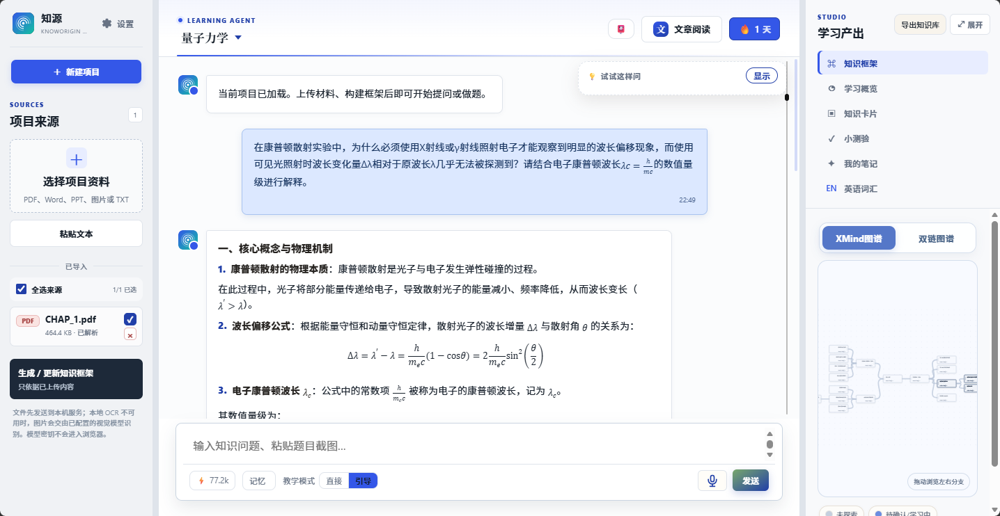
</p>
<p align="center"><sub><b>知源主界面</b>：左侧项目来源，中部 AI 学习搭子对话区，右侧学习产出工作台（知识框架 / 学习概览 / 知识卡片 / 小测验 / 我的笔记 / 英语词汇 / 导出知识库），XMind 图谱与双链图谱一键切换；底部输入框旁可切换教学模式、查看 AI 长期记忆，海小棠守在右下角。<br>（这一张是「经典工作台」布局；默认的 Agent 工作台把学习产出收成图标栏 + 浮层，见 <a href="#15-界面形态三套布局会话与可核查的对话">界面形态</a>。）</sub></p>

---

## 作品速览

### 它解决什么问题

通用大模型不了解你的课件，也不记得你学到哪。知源把「资料 → 结构 → 自测 → 补漏 → 排期」这一整段学习过程做成本地可运行的系统：先由 AI 把材料拆成可折叠的知识节点树并标出哪些还没覆盖，再用卡片与测验按薄弱点推进，**每一次学习行为都回写掌握度**，最后由自适应冲刺规划器把考前每一天倒推排出来。所有问答与解析**优先检索你自己的资料并给出出处**，证据不足时明确说「资料中没有相关内容」，不编造。

而这套系统最要紧的一条是**可核查**：AI 查了什么、读过哪些产出、改了什么，都摊开给你看——[回答依据](#7-学习问答-agent优先说你资料里的话)面板逐条摊开工具轨迹，**没查过任何东西的回答会被标红**；要改知识库必须先过你这一关。

### 关键实现（均可在本仓库核对）

| 维度 | 实现 |
| --- | --- |
| 后端 | FastAPI 单应用，`src/api_server.py` 约 3.2 万行，所有端点集中在 `create_app()` 注册 |
| 业务层 | `src/core/` **55 个模块**，一个模块一件事（框架 / 卡片 / 测验 / 知识点文档 / 支架强度 / 元认知校准 / 文献 / 英语 / 台历 / 读书 / 跨书知识网络 / 校园信源 …） |
| 前端 | **零依赖原生 JS** 单页应用，`static/` 下 46 个 JS 模块，**无打包、无构建链**，克隆即用 |
| 界面形态 | **三套布局**（Agent 工作台 / 学术极简 / 经典工作台）· 每项目**多会话** + 侧栏**项目/会话两层树**（项目行右侧一键进该项目的知识文档）· **神经图谱**沉浸视图（光球 → 模块 → 条目三层递进）· 「**回答依据**」可核查面板 · **陪练台**（提示强度 / 本轮时长 / 校准回执） |
| 读书与知识网络 | **多书源**取数（微信读书 / 豆瓣 / 古腾堡 / 维基文库 / 本地导入… 11 个源，**版权红线写进代码**）→ 书架封面墙 → 《读书收获》→ **跨书知识网络**（概念归并 · 桥接节点 · 簇级方法论 · 技能卡） |
| 存储 | SQLite 单文件 + 本地文件系统，**无外部数据库、无需注册账号** |
| 模型层 | 天津大学 AI 平台 **tju-llm**（OpenAI 兼容协议）统一调用；本地不跑权重，可整体替换 |
| 关键算法 | **FSRS** 间隔重复（移植自 py-fsrs，MIT） · **BKT** 贝叶斯知识追踪（当位阶闸门用，决定「会了 / 稳了」；**同时**驱动提示强度） · **RRF** 多源融合排序 |
| 溯源作答 | 资料切分为带位置信息的语义片段 → 检索 → 作答并附出处（RAG） |
| 写操作安全 | Agent 的写库动作一律**先出待确认卡片**，逐项勾选后才执行；可中止、可回滚 |
| 凭据 | API 密钥用 **Windows DPAPI 加密**后落 `data/`，绑定当前账户，重启不必重填 |
| 本地渲染 | KaTeX **完全本地化**（含字体）渲染 LaTeX，断网可用 |
| 工程保障 | 50 步撤销栈 + 回收站、多用户隔离（越权一律 404）、`.gitlab-ci.yml` 自带极简流水线 |

### 5 分钟走查路线

按这个顺序点一遍，就能覆盖全部核心能力。前置只需双击 **`打开知源.cmd`**（自动建虚拟环境、装依赖、开浏览器）。

| # | 操作 | 你会看到 | 对应能力 |
| --- | --- | --- | --- |
| 1 | 左栏「新建项目」→ 选一个项目资料（或直接粘贴文本） | 项目建立，资料进入来源区 | [资料导入](#1-资料导入格式不再是门槛) |
| 2 | 点「生成 / 更新知识框架」→ 右侧「知识框架」 | 材料被拆成可折叠节点树，标注覆盖 / 已学 / 掌握度 / 重要程度 | [知识框架](#2-知识框架与双链图谱) |
| 3 | 知识框架页切换「双链图谱」 | Obsidian 式图谱，颜色 = 掌握度、大小 = 连接度，孤立点与哑红节点一眼可见 | [双链图谱](#2-知识框架与双链图谱) |
| 4 | 在对话区提问 → 打开输入框旁的「Agent」开关再问一次 | 普通问答走 RAG；Agent 模式走工具循环，动作过程折成一行可展开的摘要 | [问答 Agent](#7-学习问答-agent优先说你资料里的话) |
| 5 | 顶栏点「回答依据」 | 右栏摊开每条回答读了什么、调了哪些动作；**没调工具的回答被标红**；可拖宽、可完整/还原 | [回答依据](#7-学习问答-agent优先说你资料里的话) |
| 6 | 问「我卡片里怎么写的 XX」 | Agent 去读你**真实生成的卡片 / 测验 / 笔记 / 台历 / 复习文档**，按编号逐条列出，而不是从框架里编 | [问答 Agent](#7-学习问答-agent优先说你资料里的话) |
| 7 | 让 Agent「把这几个节点连成双链」 | 回答下方出现「待你确认 N 项修改」卡片，逐项带理由，**勾掉不想做的再提交**；删除节点也走这道闸门 | [问答 Agent](#7-学习问答-agent优先说你资料里的话) |
| 8 | 侧栏点「＋ 新建会话」 | 同一项目开多条独立对话线，可重命名 / 删除；刷新回到上次那条会话 | [界面形态](#15-界面形态三套布局会话与可核查的对话) |
| 9 | 侧栏任意项目行右侧的「文档」图标 | 直接打开**那个项目**的知识文档全文，**当前项目不切换**（聊天区一动不动）；同一行的 `▸/▾` 可各自折叠、多个项目能同时展开，展开状态记在本地 | [知识点文档](#5-知识点文档把知识点讲到能复述) · [界面形态](#15-界面形态三套布局会话与可核查的对话) |
| 10 | 在对话区提问（可切换「教学模式 / 引导」） | SSE 流式作答，**优先引用你的资料并给出处**；也可让三位 AI 同学讨论 | [学习搭子](#3-学习搭子与学情洞察) |
| 11 | 图标栏「知识卡片」→ 翻面并自评（速查表里点知识点名可只看它的卡片） | 五档自评（不会 / 错误 / 模糊 / 会了 / 很熟）驱动 FSRS 排程；自评后实时回显「正确率 × 置信度 × 掌握度增量」 | [知识卡片](#4-知识卡片与间隔复习) |
| 12 | 「知识卡片」→ 内嵌速查表 → 某行点「＋文档」 | 进入全屏阅读页：左目录 + 右正文，两根分隔线都能拖宽；**选中一段原文**浮出「问 AI」，右侧抽屉**默认就勾上「也讲材料外」**——材料外补的会单独放进「材料外补充」一段，不与材料内的结论混在一起（想严守本节材料就取消勾选，没写的它会直说） | [知识点文档](#5-知识点文档把知识点讲到能复述) |
| 13 | 知识点文档顶栏「按层级合订」 | 整份改成按前置层号由浅入深排，还能只收进前几层（先合 L1~L3）；**纯本地重排，不调模型不花钱** | [知识点文档](#5-知识点文档把知识点讲到能复述) |
| 14 | 图标栏「小测验」→ 提交 | 逐题展开「来源依据 + 关键解释」，标注难度 D1/D2/D3，自评回写掌握度 | [自适应测验](#6-自适应测验不只判对错还说出依据) |
| 15 | 图标栏「学习概览」 | 打卡、日历热力图、掌握度分布与**下一步学习队列**，外加**陪练台**：这一轮该给多强的提示、这一轮大概多久、你整体高估还是低估自己 | [学习概览](#8-学习概览让努力可被度量) · [陪练台](#35-陪练台提示该给到哪一步) |
| 16 | 侧栏「学习台历」 | 三栏工作台：每天任务由「目标分 × 掌握度缺口 × 剩余天数 × 每日投入」倒推，点一下直达产出 | [学习台历](#9-学习台历与期末冲刺) |
| 17 | 图标栏「英语词汇」→ 默认就落在「📄 语料」页签 | 从**你自己导入的资料**里摘语料：英文资料零模型调用直接摘出生词密集的段落；中文资料转成英文表述并给出**术语中英对照**。点一下把生词**连原句**收进生词本，直接进 FSRS 排程 | [英语词汇与语料采词](#12-英语词汇与语料采词) |
| 18 | 图标栏「文章阅读」→ 导入一篇论文 | 版面重排、公式修复，划词即可高亮 / 翻译 / AI 解释 / 记笔记；**论文同时成为主界面里的一个项目，框架 / 卡片 / 测验 / 问答 / 台历全套功能照常适用** | [文献精读](#10-文献精读模式) |
| 19 | 右下角海小棠 → 问「最近有什么通知」 | 现场检索北洋维基 + 天大官网矩阵 + 官方公众号，**带出处与可点开的原文链接** | [海小棠](#14-海小棠与校园速递) |
| 20 | 图标栏「读」→ 书架 | 封面墙按一级领域分组；点一本 → 详情卡（简介 / 评分 / 章节 / 进度）→「看划线」「生成收获」；「搜书」页签可跨源找书，**能不能拿全文如实标出来** | [读书](#16-读书多书源书架与读书收获) |
| 21 | 读书 →「知识网络」页签 | 整张跨书网画成若干圆环，**桥接概念用琥珀色大点**标出；点桥 →「就这一簇生成方法论」，再一键沉淀成技能卡 | [跨书知识网络](#17-跨书知识网络把读过的书接成一张网) |
| 22 | 知识框架 → 顶部「神经图谱」 | 中心光球 + 顶层节点环绕；点模块 → 神经丝伞状展开到下级；点条目 → 右侧分析栏（含该节点的知识点文档 + 就地问 AI），`Esc` 逐层退回 | [知识框架与双链图谱](#2-知识框架与双链图谱) |

### 提交物清单

| 交付项 | 位置 | 说明 |
| --- | --- | --- |
| 源码（后端） | `src/` | `api_server.py` + `core/` 55 个业务模块 + `tools/`（含 CI 门禁 `ci_gate.py`） |
| 源码（前端） | `static/` | 原生 JS 单页应用，无构建链 |
| 设计说明 | `DESIGN.md` | 设计取舍与演进 |
| ~~版权合规承诺书~~ | — | 手签扫描件含个人签名，**开源版不随仓库分发**（校内 GitLab 提交版仍附该文件） |
| 第三方许可 | [下方表格](#第三方组件与开源许可) + `NOTICE.md` + `data/english/NOTICE.md` | 逐项标注来源与许可证 |
| CI | `.gitlab-ci.yml` | 零依赖极简流水线（避免 Auto DevOps 模板必然变红） |
| **演示视频（完整操作）** | [Release `demo-video-v1`][demo-video] | 约 16 分钟全程录屏（1440×738）。视频 541 MB 超出仓库承载，单独存放在 GitLab **包仓库**，从 Release 页下载即可（需登录天大 GitLab） |

[demo-video]: https://gitlab.tju.edu.cn/3023202226/agent2026-Knoworigin/-/releases/demo-video-v1

---

## 快速开始

### 方式 A：双击启动（Windows，推荐）

```bash
git clone https://github.com/gxy2574927925-0512/KnowOrigin.git
cd KnowOrigin
```

双击 **`打开知源.cmd`**，脚本会自动完成环境检测、创建 `.venv311`、安装依赖、生成 `.env`、清理残留进程、探测端口并启动服务，然后自动打开浏览器。唯一前置条件是本机已有 Python 3.11+（缺失时脚本会用 winget 自动安装）。所有依赖仅装在项目目录内，**不污染系统环境**。

> 分享给同学时**不用拷贝 `.venv311`**，换机器会失效并被脚本自动重建，会撑到几百 MB。

### 方式 B：命令行启动（跨平台）

```bash
python src/start.py
```

看到 `Uvicorn running on http://0.0.0.0:17321` 即启动成功。同一 Wi-Fi 下的手机 / 平板可访问 `logs/knoworigin-mobile-url.txt` 中的局域网地址。默认从 **17321** 起在 17321–17341 内探测空闲端口。

### 方式 C：手动启动

```bash
python -m pip install -r requirements.txt
cp .env.example .env          # Windows 用 copy
python -m uvicorn api_server:app --app-dir src --host 0.0.0.0 --port 17321
```

### 克隆下来是什么状态（干净默认态）

仓库里**不含任何密钥、也不含任何个人数据**——克隆下来就是一份干净模板：

- 服务起来后 `data/` 会自动建好（SQLite、英文词库、上传目录都在里面），不需要手动准备任何文件；
- 首次进入是一个**空工作区**：没有项目、没有资料、没有对话记录，输入框上方有一条引导条提示「现在是本地模式」；
- 点引导条上的**「去填写」**（或右上角齿轮 → **API 设置**）粘贴你自己在 [ai.tju.edu.cn](https://ai.tju.edu.cn) 个人中心拿到的密钥即可。

密钥只有两个落点：根目录的 `.env`，或 `data/local_api_config.json`（Windows 上用 DPAPI 加密、绑定当前账户）。**两者都在 `.gitignore` 里，永远不会进仓库。**

> 没填密钥也能先把界面跑起来：问答会返回内置的使用说明，其余 AI 功能会明确提示「请先配置模型密钥」，不会静默失败。
> `data/` 的完整说明见 [`data/README.md`](data/README.md)。

### 三步上手

1. **导入** —— 把这门课的课件 / 讲义丢进来（或粘贴一段文字）。
2. **生成框架** —— 等几分钟，AI 把材料拆成几十个知识点并排好层级。
3. **挑 5 个没吃透的节点各写 100 字** —— 写完一键生成卡片与测验，节点随之点亮。

> 适合谁用：正在啃一门硬课、需要把课件真正吃透的人；在写综述 / 投稿、要横向对比多篇论文的人；备考四六级与考研英语的人。

---

## 核心能力

一条主线：**导入资料 → AI 搭知识框架 → 按薄弱点引导深入 → 卡片 / 测验巩固 → 掌握度沉淀 → 学习台历排期到考前**。沿主线分布着下面这些能力：

**学习主线**：[1 资料导入](#1-资料导入格式不再是门槛) · [2 知识框架与双链图谱](#2-知识框架与双链图谱) · [3 学习搭子与学情洞察](#3-学习搭子与学情洞察) · [4 知识卡片与间隔复习](#4-知识卡片与间隔复习) · [5 知识点文档](#5-知识点文档把知识点讲到能复述) · [6 自适应测验](#6-自适应测验不只判对错还说出依据) · [7 学习问答 Agent](#7-学习问答-agent优先说你资料里的话) · [8 学习概览](#8-学习概览让努力可被度量) · [9 学习台历](#9-学习台历与期末冲刺)
**工作台形态**：三套布局可切换（默认 Agent 工作台）· 每项目多会话 · 「回答依据」可核查面板（均见 [界面形态](#15-界面形态三套布局会话与可核查的对话)）
**论文与文献**：[10 文献精读模式](#10-文献精读模式) · [11 论文检索与科研工作台](#11-论文检索与科研工作台)
**英语应试**：[12 英语词汇与语料采词](#12-英语词汇与语料采词) · [13 考研精读与作文升格](#13-考研精读与作文升格)
**读书与知识网络**：[16 读书](#16-读书多书源书架与读书收获) · [17 跨书知识网络](#17-跨书知识网络把读过的书接成一张网)
**陪伴与形态**：[14 海小棠与校园速递](#14-海小棠与校园速递) · [15 界面形态](#15-界面形态三套布局会话与可核查的对话)

### 1. 资料导入：格式不再是门槛

支持 PDF、Word（`.docx`）、PowerPoint（`.pptx`）、图片与纯文本，也支持直接粘贴网页或笔记文字。另内置天津大学课程库 **116 条元数据**（课名 / 课程号 / 学科标签，其中 113 条带课程号、另 3 条是体育 / 大学英语 / 文化素质选修三类公共项），按课名自动补全、一键建项目（**只收元数据，不含任何课件资料**）。

PDF 优先走文本层提取（PyMuPDF + pdfplumber），扫描版或图片型页面自动启用 RapidOCR 兜底。导入后的资料被切分为带位置信息的语义片段，保留公式 LaTeX 与图表引用关系，作为后续所有能力「溯源」的基础。

### 2. 知识框架与双链图谱

导入资料后，AI 把材料结构化为一张可折叠的知识节点树：章节是主干，定义与公式是分支，例题和边缘补充是叶子。每个节点自带四类状态：**覆盖**（材料里有没有讲到）、**学习状态**（学过 / 在学 / 没碰）、**掌握度**（由提问、做题、翻卡、测验加权计算）、**重要程度**（AI 按出现频次与依赖关系打分）。随着你不断学习，节点颜色从灰 → 蓝 → 金逐步点亮。框架生成全程**流式呈现真实进度**（解析 → 抽取 → 连链 → 渲染，各阶段实时推进而不是假进度条），整个框架还能一键**导出 XMind** 带去别处继续用。

<p align="center">
  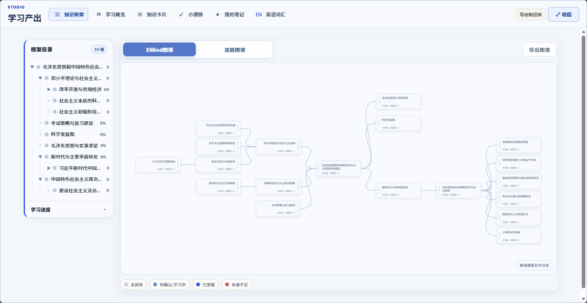
</p>

树回答「这份材料讲了什么」，**Obsidian 式双链图谱**回答「这些东西之间是什么关系」：在笔记里写 `[[德布罗意波长|物质波]]` 即成链（支持别名、实时反查反向链接），也可以让整理助手推荐该连而未连的节点、找出图谱里缺失的知识点（执行前先存快照，误建可撤销）。**颜色 = 掌握度，大小 = 连接度**，孤立的小点和哑红的节点一眼可见。

<p align="center">
  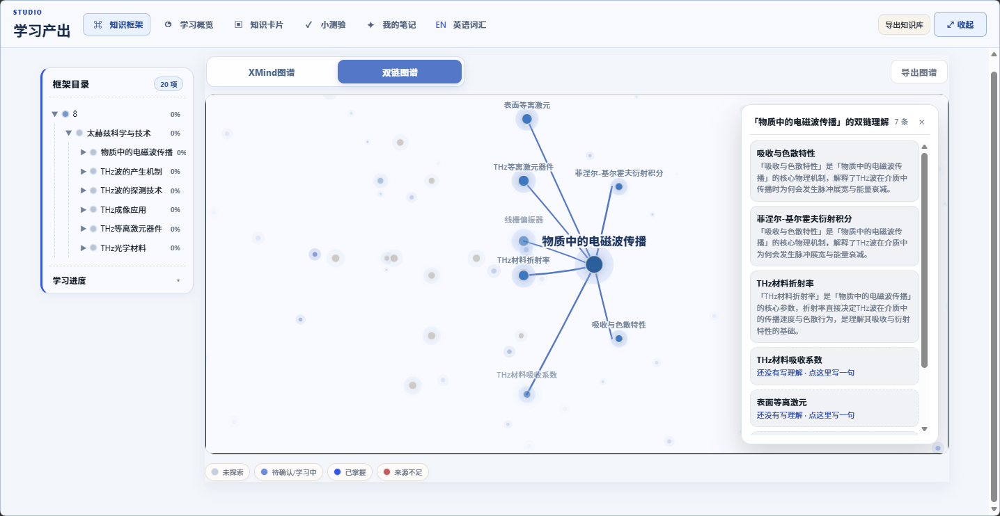
</p>

双链不是装饰：笔记里的 `[[双链]]` 会实时反查反向链接，并能据此一键生成卡片。

**图谱节点单击就开「语义护照」**：掌握度、出处、双链理解一页看完；**还没有双链的节点也给浮层**，在里面就地说清「缺的是哪一步」（以前只弹一句「还没有双链连接」，容易被读成「这个节点没建立」）。拖动与点击分开判定（`pointerdown` 守卫），所以拖图不会误触发浮层；单击与 Enter / 空格都走常驻事件委托，渲染链某一环出问题也点得动。

框架另有一档**全屏沉浸视图「神经图谱」**：把「总览 → 模块 → 单条 → 分析栏」四层显式化——中心一颗光球是整份材料，顶层节点化作模块环绕游动；点模块，它的下级节点向右**伞状展开**；点条目，右侧滑出该节点的掌握度、上下级、知识点文档，并能**就地就这一节问 AI**。每一层只回答一个问题，`Esc` 与面包屑逐层退回；底部另有不调模型、秒出结构化事实的「图谱速览」。

<p align="center">
  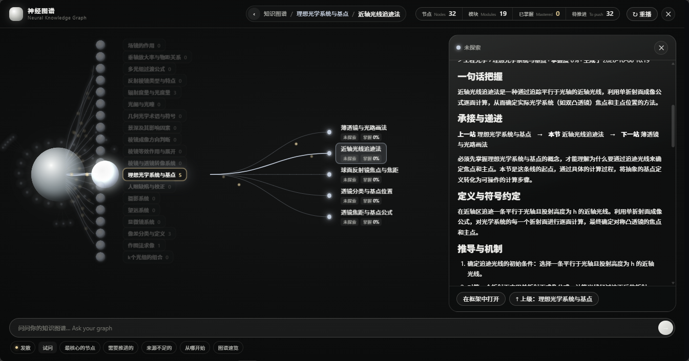
</p>
<p align="center"><sub><b>神经图谱 · 总览</b>：中心光球是整份材料，四周环绕它的顶层模块；左栏目录索引列出每个模块的下级节点数。</sub></p>

<p align="center">
  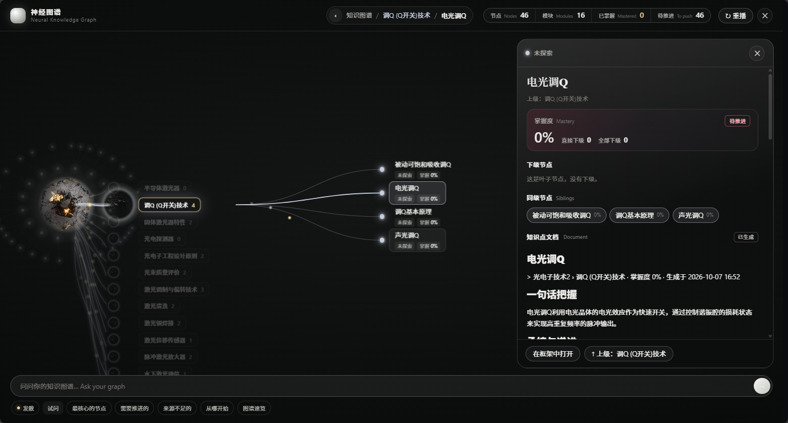
</p>
<p align="center"><sub><b>神经图谱 · 节点分析</b>：点模块 → 下级节点伞状展开 → 右侧分析栏给出掌握度、同级 / 下级节点、知识点文档与「一句话把握」，并可就地就这一节问 AI。</sub></p>

> 它是纯前端增强层：脚本排在 `app.js` 之后、只读它的顶层状态，删掉 `index.html` 里两行即完全回退。

### 3. 学习搭子与学情洞察

学习最怕「知道该复习，但不知道从哪里开始」。学习搭子先看一遍知识框架，按薄弱节点排优先级，再针对当前节点选择对话方式：

<details>
<summary>展开看三种对话方式的分工（整理助手 / 苏格拉底引导 / AI 同学讨论）</summary>

| 入口 | 谁在说话 | 你要做什么 | 什么时候用 |
| --- | --- | --- | --- |
| **整理助手** | AI 给笔记建议稿、补漏清单、双链推荐 | 你挑、你批准 | 刚建完项目不知从何下手 |
| **苏格拉底引导** | AI 只反问，不直接给答案 | 你自己写结论 | 想验证「我是不是真懂了」 |
| **AI 同学讨论** | 三位 AI 同学互相讨论 | 可插话，可只听 | 想换角度看这一节 |

</details>

**学情洞察**把 BKT（贝叶斯知识追踪）当**闸门**用，而不是把一个分数摆给你看：一个知识点要算「会了」，必须验证据 ≥2 且 BKT 越过阈值——所以「在同一节点连问 13 次就掌握」这条路走不通。**把握度自评**补齐另一半：每道题作答时顺手勾一下「我确定 / 我不确定」，于是「答错了但当时很确定」（**误以为会**）和「答对了但心里没底」（待巩固）都能被标出来，前者第二天排进「先修这个」；没勾的一律不猜；**教学模式**提供 direct / guided 两档讲解口径，让 AI 的引导方式跟着你的状态走。

### 3.5 陪练台：提示该给到哪一步

上面那条护栏有个缺口，值得单独说清楚：项目引用了 Bastani et al., PNAS 2025（无护栏的 GPT-4 让练习时成绩 +48%，撤掉 AI 后考场上 **-17%**；带护栏的版本练习时 +127%、考场上回到对照组），但那条护栏**只做在了「苏格拉底引导」一档**上。默认档位（直接答）下没有护栏，而全仓唯一把掌握度接进提示词的地方是个**单向**的判断——只会「多给一点」，永远不会「少给一点」。于是「稳了」的节点照样被逐题喂完整答案：这就是 Kalyuga et al. (2003) 的**专业知识反转效应**，冗余支架对已有图式的人从帮助变成干扰，而用户只会觉得「这题我明明会，它还啰嗦半天」。

**陪练台**（学习概览里的一张卡）把那条单向的判断换成一条五档、**会往上也会往下走**的梯子：

| 档位 | AI 给你什么 |
| --- | --- |
| 给完整例题 | 整条步骤都给你，你只负责跟一遍，看哪一步开始跟不上了 |
| 给半程例题 | 前两步给你，最后一步你自己补 |
| 只给要点骨架 | 只写每一步叫什么，内容留给你 |
| 只点第 1 步 | 只点方向往哪走，后面你自己推 |
| 不给提示 | 什么都不给，做完我再对照 |

当前落在哪一档**由证据说了算**（BKT 后验 + 位阶），并且明确写出「为什么是这个强度」以及「再往前一档是什么、你够不够格撤」。四条边界不让它乱来：位阶没过「会了」时不往下撤（不会的东西不配叫「合意困难」）、证据只有 1 条时不往下撤（BKT 那时还几乎是先验）、**换情境时反而加回一档**（同一个概念换成新题型考，你对新任务就是新手）、位阶说「稳了」但证据不支持时按证据给足支架（卡片翻熟不等于会做）。

陪练台另外两块：**这一轮有多久**——只给分钟数，**不给你「还有 47 张卡片待复习」**（件数与能力评价耦在一起是自我决定理论里典型的不合意压力，件数只用来决定休息插几次）；**你准不准**——把你勾过的「我确定 / 我不确定」聚合成一句结论（整体高估 / 整体低估 / 基本吻合），**高估和低估给的是不同建议**（Double et al. 2025 那项研究里校准训练只对过度自信者有效，对过度谨慎者无效）。样本不足 8 条时它会说「还看不出来」，而不是用 3 次作答编一个「你高估自己」出来。

另外它**刻意不新增每题必答的把握度**：Double et al. (2025, N=710) 的预注册结果表明，逐题索取 confidence 会把人推向「保表现」的保守策略、损害规则学习与迁移。什么时候值得再追问一次，由系统按「准确率是否落在中间带」决定，并在卡片上写明理由。

### 4. 知识卡片与间隔复习

按知识点生成「正面设问 + 背面来源依据 / 关键解释」的可翻面卡片，公式用 `$...$` 原生 LaTeX 渲染（KaTeX 完全本地化，断网可用）。翻面后按**五档自评**（不会 / 错误 / 模糊 / 会了 / 很熟），调度基于 **FSRS 间隔重复算法**：到期卡片自动排进复习队列，先把快忘的送回来。

「知识卡片」与「小测验」顶部内嵌**速查表**：全课程术语 / 公式一页扫读（一句话含义 + 成立条件与易错点），每个知识点旁一键「＋卡片 / ＋测验」按需批量生成——速查不是终点，顺手就能转成练习。**点知识点名**则把下面的卡片筛成只剩它的那些（父节点连整支子树一起算，再点一次或按「看全部」复原），编号顺延重排——在几十张卡里找某一节，就靠这一下。

<p align="center">
  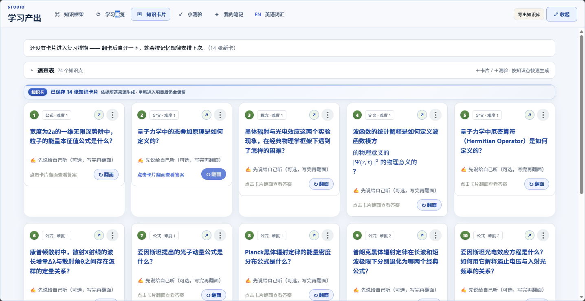
</p>

自评不是打完就忘：系统实时回显这次的「正确率 × 置信度 × 掌握度增量」，并解释为什么加了这么多分。

两个默认保守、随时可改的界面细节：卡片**翻面后默认只露一个「展开答案」**，想看正文再点（长答案不会一屏铺满，切走再回来仍保持）；**悬停辉光默认关闭**（设置 →「卡片辉光」可开），因为长时间刷卡片时发光会累眼。

学过的东西不会散掉：做过的题、翻过的卡自动沉淀进**我的笔记**，按**测验键 / 助记卡片**归档，划词高亮与自己的批注也集中在这里回看、修改。

### 5. 知识点文档：把知识点讲到能复述

框架上的节点只写着「相位测量」四个字，考前想从头读一遍，却发现没东西可读。**知识点文档**把每个节点展开成一份复习用详解：一句话把握、定义与符号约定、推导与工作机制、公式与用法、易错点与常见混淆、与相邻知识点的关系、自测问答 —— 写的是能从头读到尾的材料，不是术语清单。

入口就在**一页速查表**：每个知识点后面挂一个「＋文档」，顶栏另有「一键生成整份文档」——逐个生成还没写过的节点，再**合订**成一份带目录的长文，随时可停。

- **逐知识点深挖** —— 一次只讲一个概念，且受两条硬约束：事实不越出资料范围，框架里没有的相邻知识点不许编造。资料没覆盖的小节一律留空，并**如实标注「本次由本地兜底填充」**，不拿学科通识硬凑。
- **递进关系分两层** —— 坐标（第 N 站 / 第 M 层 / 承接谁 / 引出谁）全部由本地按前置关系算出，**只有「为什么这个顺序不能颠倒」交给模型**，模型的坐标输出一律被框架值覆盖。合订稿的目录据此挂上「第 M 层」徽标。
- **选中原文就地提问** —— 读详解时选中一段话，右侧抽屉作答（SSE 流式）；**默认勾上「也讲材料外」**——材料里有的优先按本节材料，材料外补的会单独放进 `## 材料外补充` 一段自报家门，不与材料内的结论混在一起。**取消勾选**就回到严守本节材料的口径：材料里没写的直说「材料里没写」，需要推断时标明这是推断。
- **合订有两种读法，按需切换** —— 「按层级合订」可以把整份改成**按前置层号由浅入深排**（第 1 层一章、第 2 层一章…，每章前一句「这一层要先拿下前 N 层」），还能顺手**只收进前几层**：刚入门时先合一份 L1~L3，读熟了再放到 L5。两种都只是本地重排，不调模型、不花钱。默认仍是按框架章节排（与速查表一致）。之所以两种都要：框架树按章节组织、层号按依赖算，本来就不对齐 —— 按章节排会出现「L1 之后直接跳到 L8」。
- **两侧栏可以拖宽** —— 目录和右侧提问抽屉都能拖分隔线调宽度（分隔线本身就是拖动区，命中范围比看上去宽），宽度记在本地、关掉再开还在；双击分隔线复位。窄屏下目录收起、抽屉浮起，对应的分隔线自动隐藏。
- **正文点进去就能改** —— 正文是 `contenteditable` 的 Markdown，不要按「编辑」按钮：点一下就能敲字，打字过程中防抖自动保存（顶栏会写「已保存 时:分」）；公式是整块 `contenteditable=false`，退格键不会啃掉半个公式。手工改动盖在模型生成结果之上，**重新生成会用模型结果覆盖它**（这是有意的，所以「重新生成」前会先确认）。
- **带走是标准 Markdown** —— 一键复制或下载 `.md`，可直接进 Obsidian、进打印稿。

<p align="center">
  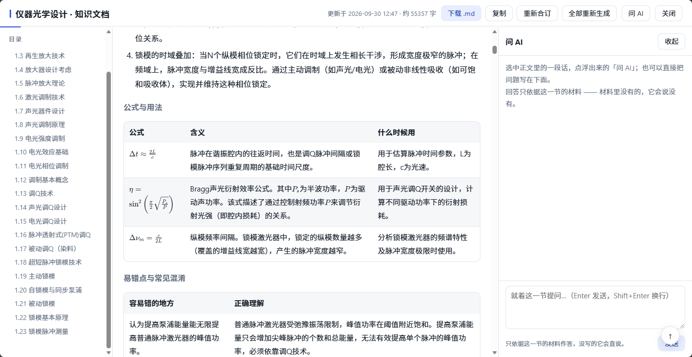
</p>

### 6. 自适应测验：不只判对错，还说出依据

覆盖**单选、多选、不定项、填空、简答、计算**等题型，难度按 D1 识记 / D2 理解 / D3 迁移三级递进。提交后逐题展开**「来源依据」与「关键解释」**——告诉你这句话出自资料的哪一段，而不是只给一个答案字母。自评结果直接回写掌握度，形成**学 → 测 → 补**闭环。

<p align="center">
  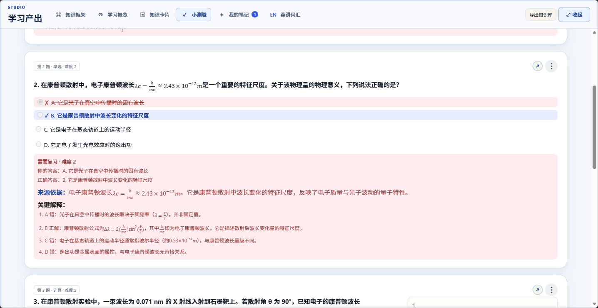
</p>

**掌握度不会被刷分**：每次学习事件都会记录「正确率」与「置信度」，当 AI 对「这道题考的是哪个知识点」把握不足时，该次记录进入**「待确认」且不加分**（阈值见 `src/core/framework.py` 的 `MASTERY_CONFIDENCE_FLOOR`），避免错配的知识点污染掌握度。

### 7. 学习问答 Agent：优先说你资料里的话

在对话区直接提问，或发送题目截图，Agent 以 RAG 方式**优先检索你已上传的资料**作答，输出结构化、含公式的标准答案，SSE 逐字返回。证据不足时明确说「资料中没有相关内容」，不编造。**AI 长期记忆**会从对话里沉淀你的背景、目标与讲解偏好（声明式信息由你自己确认，AI 只补项目级上下文），陪学对话自动带上；所有记忆在学习产出区可见、可改、可删。

输入框左侧有一个 **「Agent」开关**（默认关闭，关着就是普通问答）。打开后这一屏的提问走**工具循环**：AI 自己决定检索什么、查什么、能改什么，动作过程折成一行可展开的摘要。

<details>
<summary>展开看：Agent 模式能读什么、能改什么（27 个工具，读与写分开授权）</summary>

| 类别 | 能力 | 举例 |
| --- | --- | --- |
| **读你的资料** | 检索资料片段、看资料清单、检索知识库 | 「这几章里怎么讲受激辐射的？」 |
| **读你的学习产物** | 读知识卡片、读小测验、检索我的笔记、读速查表 / 学习路径 / 清单报告、读学习台历与冲刺计划、读复习文档、读知识点文档 | 「我卡片里怎么写的德布罗意波长？」「我上次测验考得几分？」 |
| **读你的学情** | 查掌握度、查知识框架、读节点详情、读知识库摘要 | 「哪个知识点我最该补？」 |
| **写知识库**（需你确认） | 新建节点、更新节点、删除节点、建立双链 | 「把这几个节点连成双链」 |
| **校内** | 校内资讯 | 「最近有什么通知？」 |

三类设计约束：

- **读产物是本轮新增的**。以前 AI 只能读资料和框架，「我卡片里怎么写的」这类问题它只能从速查表里编；现在它读的是你真实生成的卡片、测验、笔记与台历，按编号逐条列出。
- **写操作一律先问**。AI 说「要新建节点 / 建双链 / 删节点」时**不直接改库**，回答下方摊开一张**待确认卡片**（「待你确认 N 项修改」），每项带中文理由，可逐项勾掉再提交；删除节点这类破坏性操作也走同一条闸门。AI 还会给「接下来可以这样学（N 项）」的可勾选清单（生成卡片 / 小测验 / 复习文档 / 速查表 / 学习路径 / 清单，或直接跳到对应页），**提交前不会生成任何东西**。
- **没建框架也能问**。刚传完 PDF 还没生成框架时，问「我存了什么」不会被「请先构建知识框架」挡回去。

两条容易被忽略但决定这条链路好不好用的细节：

- **节点定位口径四处一致**。模型手上通常只有节点名（用户说的、框架里看到的），而工具 schema 要求 `node_id`。所以读节点详情与三个写工具共用同一套定位：**给 id 用 id，给名字用名字**。以前只有读工具做了这层回退，写工具只认 id —— 于是模型很自然地传了名字，端点回「节点不存在」，用户点了提交却什么都没发生。
- **失败必须被报成失败**。写工具的每一条失败分支都带统一标记，执行端点据此判失败并把内部前缀剥掉再回前端。这一条是踩过坑才加的：此前判定只看「是不是在要确认」，于是「节点不存在」「已存在同名节点」全被当成成功 —— 前端显示「✅ 全部完成」加绿色提示，而知识库一个字节没变。**假成功比报错难查得多，因为它看起来是成功的。**

回归由 `tools/verify_agent_write_gate.py` 钉住（不调模型、不需要 key，全程本地库），覆盖：失败必须报失败、节点名当 id 用、同名重复必须拦住、同一批里后一个动作依赖前一个新建的节点、破坏轨自行补 confirm、白名单拒绝任意函数名。

</details>

> 网关实测不提供原生 Function Calling，工具调用靠「模型输出约定 JSON → 本地解析」实现（`src/api_server.py` 里的 `_LiteralToolCallAccumulator` 同时接住 XML 与两种畸形 JSON 形态）。

**「回答依据」：把这一问的来龙去脉摊开给你看。** 顶栏点「回答依据」滑出右栏，每条回答一张卡，写清它读了什么、调了哪些动作、命中几条；工具按「资料 / 成文产物 / 知识库 / 写入」四色分类，点开看这次调用的返回。**完全没调工具的回答会被明确标红**——「没有调用任何工具，这一条的内容来自模型自己的知识，没有依据你上传的资料、生成的知识文档或卡片」。顶部环形图统计这段对话里有多少比例的回答真的查过资料。可以拖宽、可以「完整 / 还原」收成窄边、刷新后自动恢复，鼠标划过某条时对话区对应那条会高亮。

### 8. 学习概览：让努力可被度量

自动聚合提问、做题、翻卡、测验四类行为，生成**连续学习打卡、学习日历热力图与掌握度分析**。掌握度算法透明可解释，可下钻查看每个分数的构成，并直接给出**下一步学习队列**——队列里的优先级可由 AI 生成**复习建议**（说明为什么先学这个、前置堵在哪），支持一键更新与手动编辑。

<p align="center">
  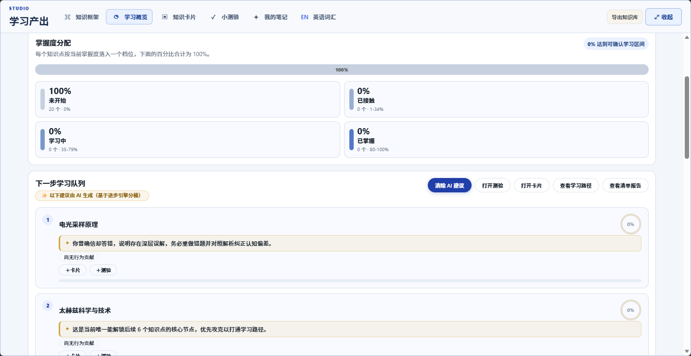
</p>

### 9. 学习台历与期末冲刺

**学习台历**是三栏工作台：左栏课程导航（一页速查表 / 学习路径），中栏月历 ⇄ 课程页互斥切换，底部「当日计划 / 当日记录」页签，右栏考期备忘。台历上的每一天都由后端的**自适应冲刺规划器**算出来：按「目标分 × 掌握度缺口 × 剩余天数 × 每日投入」推出强度，倒推三阶段（全景筑基 → 难点攻坚 → 全真自测）装配每日任务，任务直达产出——看考点、生成卡片、出小测验、复习到期卡，点一下就进对应界面。「看考点」会打开**单节点补课规划**：AI 按你的掌握度缺口给出几天的补课清单，关掉弹窗也在后台继续生成，回来直接看结果。支持四档模式（3 天抢救 / 7 天稳健 / 14 天高分 / 自定义）与 RFC-5545 ICS 导出。

<p align="center">
  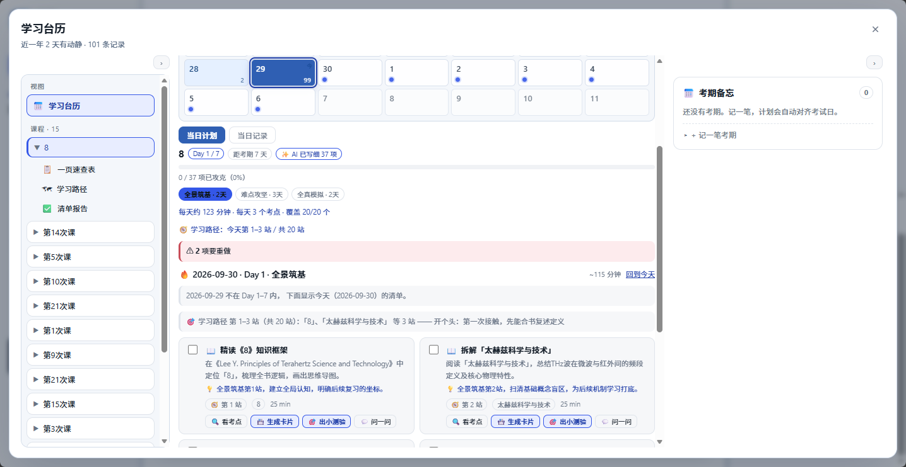
</p>

每天的清单不止是文字：勾选「精读《论》知识框架」「拆解《太赫兹科学与技术》」就能直接进入对应产出；课程页里还有 AI 生成的**一页速查表**——术语 / 公式 × 一句话含义 × 成立条件与易错点，考前一页扫完全课。

<p align="center">
  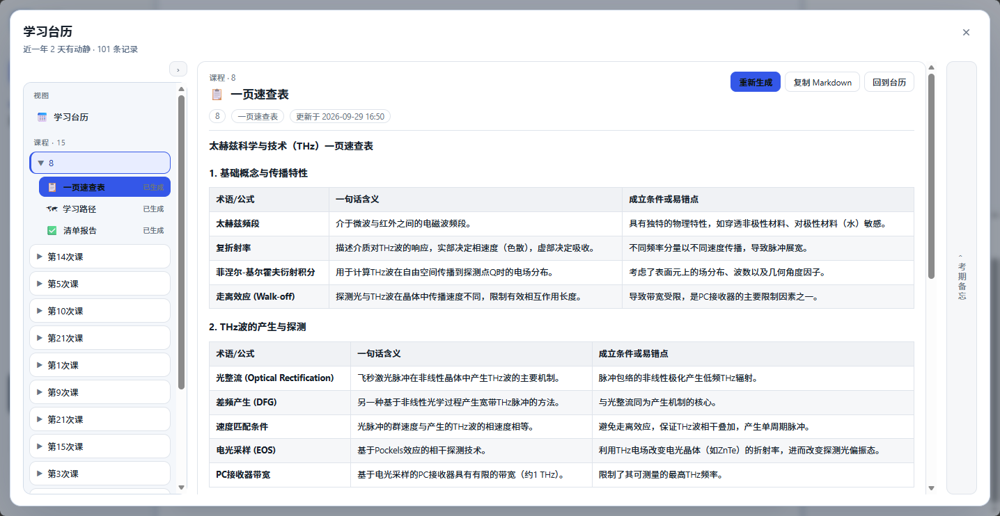
</p>

### 10. 文献精读模式

读论文时，公式、图表、术语、引用关系堆在一起。顶部点「文章阅读」进入论文精读环境：导入 PDF 后自动做版面重排与公式修复，划词即可**高亮 / 翻译 / AI 解释 / 记笔记**，关键图表自动解释，全文中英对照，三栏同步推进。

- **AI 解释公式 / 图表** —— 自动解释符号含义、推导过程、实验流程与数据趋势
- **相关原文定位** —— 一句提问或一个关键词，直接把原文里最相关的段落连**页码与相对置信度**列出来（黄色越深越相关），拖阈值筛、按「原文顺序 / 相关性」排，点一条就跳到原页对应位置并框出来。扫描件会明说「没有文字层」，不给一个空列表充数
- **全文翻译** —— 中英对照呈现，保留公式与图表位置；划词即可单独翻译
- **文献管理** —— 「我的文献」集中管理已导入论文，保留阅读进度

> **精读不是孤岛：从「文章阅读」导入的每一篇论文，同时就是主界面里的一个项目。** 返回主界面后，它与课件导入的项目享有同一套能力——生成知识框架、出卡片与小测验、对话问答、沉淀笔记、排进学习台历，一样不少；顶部的项目列表实时同步，删除论文也会同步移除。**读论文起手，走完的仍是知源完整的学习主线。**

<p align="center">
  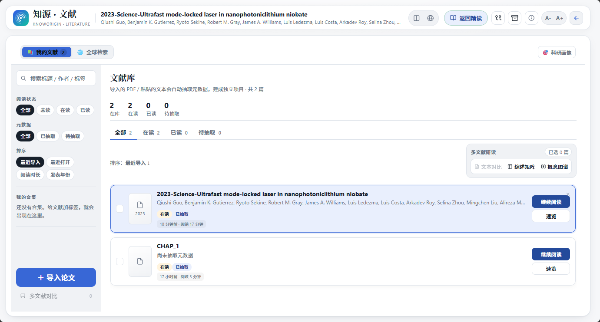
</p>

<p align="center">
  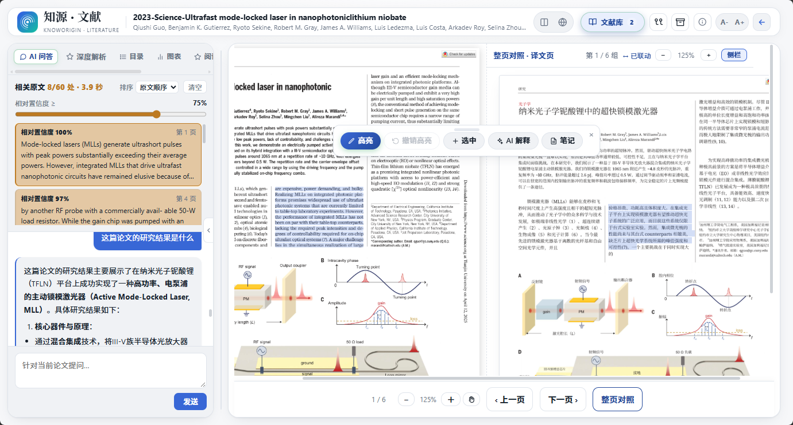
</p>

对比与溯源能力同样内建：勾选多篇论文可生成「研究问题 / 方法 / 贡献 / 结果 / 局限」对照表，整理助手随后通读知识库，找出**知识空白、可直接引用的论断、资料之间的张力**，每条都给出处；**来源视图**把「资料 → 概念」画成二部图，多源共同支撑的概念高亮为交叉验证，孤证提示需要补来源。

### 11. 论文检索与科研工作台

**论文检索**走四层管线：查询改写 → 多源并发（Europe PMC / Semantic Scholar / arXiv / OpenAlex）→ RRF 融合 → 规则精排，全程零模型调用也可降级可用，并如实标注每个源的可用状态。**科研工作台**面向写综述与投稿：PRISMA 式系统综述矩阵（8 维横向抽取、空白 Gap 标注、CSV 导出）+ 模拟顶刊同行评审的红队（Soundness / Novelty / Rigor 打分、致命挑刺、抢救性实验与反驳防守策略）。

### 12. 英语词汇与语料采词

内置 CET4/6、考研等词书（ECDICT 数据衍生），FSRS 调度 + 拼写模式 + 记忆曲线。更进一步的是**语料采词**：生词不是从词书里背来的，是从你正在读的材料里长出来的——英文资料零模型调用直接摘出生词密集的段落，中文资料过模型转写成英文语料并附术语中英对照，还会把 PDF 抽出来的残稿整理成通顺的中文对照稿；收进来的词若只有英文注释，会自动从资料的中英对照或词典补上中文释义。每个词都带原句语境，划词即可手动收进生词本。

### 13. 考研精读与作文升格

面向考研英语的专业工作台：前沿学科主题 → 权威期刊 → 篇章的三级级联选文，联网泳道按时间倒序抓取可读全文（11 个源，带时效过滤）。每个篇章带六维深度解析：**全文精准精译、主旨与态度雷达、长难句手术刀拆解、同义替换直通 FSRS、熟词生义预警、命题陷阱选择题**。

**作文 AI 升格批改**：粘贴四六级 / 考研作文，先「规则体检」（字数、段落、中式英语、可升级词、句式级差）再「AI 升格」，给目标档位点评与逐句改写；配套**写作工具箱**（模板句型、替换词库、过渡词、中式英语对照、评分标准）和**翻译训练**（文化负载词、高分短语、评分自查）。每次演示结果都留历史记录，其中的精华自动回填进工具箱。

### 14. 海小棠与校园速递

一只叫「海小棠」的小花仙桌宠，**17 个动作 × 6 帧真·逐帧动画**：答题顺了撒欢，久没动静会凑过来问一句。它能悬停卡片即时给提示、在双链图谱里带路陪游、直接回答校内事务（北洋维基 + 天大官网矩阵 + 官方公众号现场检索，带出处与**可点开的原文链接**，查不到直说）。

**校园速递**把 60 个天大公众号收成一份订阅库：最近推文按时间倒序、教务奖助类标红，关注清单可自己增减；海小棠回答「最近有什么通知」时直接引用新推文并标注发布时间。

### 15. 界面形态：三套布局、会话与可核查的对话

除了「有哪些能力」，知源还有一层「**这些能力怎么摆在你面前**」的设计。

**三套布局，设置里随时切**（`html[data-ui]` 决定）：

| 布局 | 形态 |
| --- | --- |
| **Agent 工作台**（默认） | 左侧图标栏（知识框架 / 学习概览 / 知识卡片 / 小测验 / 我的笔记 / 英语词汇 / 文章阅读 / 设置 / 全屏）+ 项目与会话侧栏（**两层树**，项目行右侧一键进该项目的知识文档）+ 整屏对话区。学习产出与项目资料都以浮层呈现，助手回答不装气泡、直接落在纸面上。 |
| 学术极简 | 窄侧栏 + 长文阅读式的框架视图，冷蓝配色。 |
| 经典工作台 | 传统左资料 / 中对话 / 右产出三栏。 |

**界面另有两层纯样式增强**（`styles-polish.css` 填空、`styles-immersive.css` 定调），只改观感、不含任何逻辑，各删一行 `<link>` 即完整回退。

**每个项目可以开多条会话。** 侧栏「＋ 新建会话」开一条独立对话线，标题留空时自动取首条提问的前 40 字；悬停出「⋯」可重命名或删除（删除进撤销栈，可回滚；**只删对话，项目资料、框架与学习产出不受影响**）。当前会话记在本地，刷新自动回到上次那条。数据库侧只加了一张 `chat_sessions` 表存会话壳（标题与时间），消息本体仍在 `messages` 表里按 `conversation_id` 关联 —— 老数据不迁移也能正常用。

**侧栏是一棵两层树：项目 → 会话。** 点行首 `▸/▾` 折叠或展开某个项目，**多个项目可以同时展开**（展开状态记在本地，默认只展开当前项目）；点项目名则进这个项目并自动展开它。**每个项目行右侧常驻一个「知识文档」图标**：点它直接打开那个项目的知识文档（合订稿全文），**但不切换当前项目** —— 你在 A 项目聊着天想瞄一眼 B 的文档，聊天区一动不动；而文档页里的「合订 / 全部重新生成」操作的也正是 B，不会串到 A。展开着别的项目时点它下面的会话或「⋯」，会先去那个项目再照原样处理。

**「回答依据」是这一层设计的核心。** 一个会调用工具的 AI，天然带来「它凭什么这么说」的问题。知源的回答不是给一段免责声明了事，而是把**每一次工具调用的痕迹做成可逐条审阅的时间线**：

- 每条回答一张卡，写清读了什么、调了哪些动作、命中几条；工具按「资料 / 成文产物 / 知识库 / 写入」四色分类，点开看这次调用的真实返回。
- **没有调用任何工具的回答会被单独标出来**（虚线框 + 红点），并直说「这一条的内容来自模型自己的知识，没有依据你上传的资料、生成的知识文档或卡片」。顶部环形图统计整段对话里有多少比例的回答真的查过资料 —— 一个会话做到最后，这个数字会告诉你它到底靠不靠谱。
- **写库闸门与依据面板同屏** —— 这是这一层设计的关键：左边摊开「你要不要执行这 N 项」，右边摊开「它这一问到底查了什么」。**你可以一边看 AI 打算改什么，一边核对它凭什么这么说**，而不是只能事后看结果。
- 面板**挤压**对话区而非盖住它；左缘分隔线可拖宽（300–760px，键盘 `←/→` 也能调，双击复位），或一键「完整 / 还原」收成 52px 窄边把宽度全让给对话；上次是开着的，刷新后自动恢复。
- 鼠标划过依据栏某条，对话区对应那条高亮、其余压暗；点一下才真的滚过去（hover 不滚，避免抖动）。

<p align="center">
  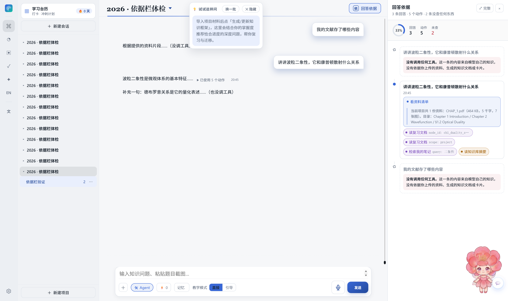
</p>
<p align="center"><sub><b>回答依据面板</b>：右侧按轮次摊开工具轨迹，工具按「资料 / 成文产物 / 知识库 / 写入」四色分类，点开看这次调用的返回；完全没调工具的回答被明确标红，顶部环形图统计整段对话里有多少比例的回答真的查过资料。</sub></p>

<p align="center">
  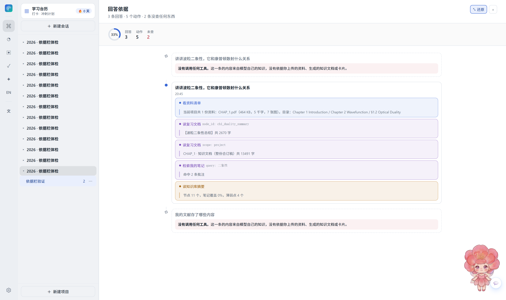
</p>

其它几个为「可核查」服务的细节：答案里的来源编号 `[n]` 是**可点的 chip**，点了高亮原文，而且只报本轮**真正引用过**的资料（不是「勾选中的全部资料」）；模型整轮没碰资料时会自动兜底补一次检索，并在轨迹里如实标成自动补的；知识点文档里的提问**默认就勾上「也讲材料外」**——材料外补的整段放进 `## 材料外补充` 自报家门，不与材料内的结论串台（想严守本节材料就取消勾选）。

**「试试这样问」可以挪走。** 顶栏右侧那颗推荐问题药丸，拖标题行就能移（位置记本地），右键能整个关掉或恢复默认位置；设置里也有对应开关与「重置推荐问题位置」。

### 16. 读书：多书源、书架与读书收获

知源不只想管课件，也想管**书**。图标栏的「读」是一个完整的读书模块：**书架封面墙 + 跨书源找书 + 《读书收获》**，并且——这是和「同步到 Notion」那类项目最不一样的地方——**一本书读完的产出会直接接进学习主线**：划线能出卡片、收获能出测验、整本书能变成一个项目走完框架 / 掌握度 / 台历全链路。

**多书源，每个源都如实说明自己到底能给什么。** 知源内置 **11 个书源**（微信读书 / 豆瓣 / 古腾堡 / 维基文库 / 中国哲学书电子化 / Standard Ebooks / Open Library / Google Books / Internet Archive / HathiTrust / 本地导入），注册表里逐源标注 **`has_fulltext`（能不能拿全文）/ `rights`（版权状态）/ `needs_proxy`（国内网络可不可达）**，不让上层去猜。

- **版权红线写进代码，不靠自觉**：`has_fulltext=True` **只对 `public-domain` 与 `user-provided` 放行**，由归一化函数强制。商业书即使碰巧有下载链接，也会被降级成「无全文」，取全文接口直接拒绝并说明原因——**杜绝「不小心把有版权的书当公版书下全文」**。
- **单源失败互相隔离**：防线下沉到每个源，任一源超时/报错只算 0 条，绝不让整轮搜索炸掉；并且**失败会被如实记成失败**，界面上「书源全挂」和「确实没这本书」是两句不同的话。
- **国内可达性实测过**：古腾堡 / Open Library / Google Books 在国内网络基本不可达，所以**豆瓣**（`/j/subject_suggest`，唯一稳定的中文书目源）排在搜索源第一位，微信读书与本地导入是主路径。

**微信读书走官方 Agent API，不用爬虫。** 统一入口 `POST /api/agent/gateway`，`Bearer wrk-` 密钥鉴权，官方直接返回书架、**封面 URL**、阅读进度、划线、想法、阅读统计与个性化推荐。密钥沿用与模型 Key 同一套凭据链（环境变量 → `data/local_api_config.json` 的 DPAPI 密文），**响应绝不回显，也不进仓库**。

> **一个必须说清的边界**：微信读书官方接口**给不了整本正文**——正文留在它的 App 里读，这是商业边界，不是接口缺陷。所以微信读书的书只做「章节目录 + 每章最热原文片段」的**精华阅读**（诚实标注「不是全文」）；**要真·全文就本地导入**（走既有的上传 / 解析 / OCR 链路），这是唯一可靠的解法。

**书架是封面墙，按一级领域分组。** 分类**不依赖模型**：`guess_category()` 是纯规则函数（关键词最长匹配，所以「经济学」不会被「经济」抢走），模型不可用时书架照样分得开，而不是全部掉进「其他」。每本书底下一行一句话定位，点开是完整介绍（简介 + 主题标签 + 入门/进阶/专业 + 什么情况下读），介绍**可以自己改**——AI 原稿留在 `content_json`，你改的是 `content_md`。

**《读书收获》才是这个模块的目的地。** 输入只有两样东西：**你自己的划线 / 想法**，加上书籍自带的简介。产出是一份结构化文档：

| 字段 | 回答什么 |
| --- | --- |
| `thesis` | 这本书一句话在讲什么 |
| `core_arguments[]` | 核心论点 + 怎么论证的 + 出处 |
| **`models[]`** | ⭐ **可复用的模型 / 框架**：是什么 · **什么场景怎么用** · 出处 |
| `insights[]` | 反常识点：大多数人以为 → 书里说 → **差在哪一步** |
| **`actions[]`** | ⭐ 明天就能用的清单（动词开头） |
| `quotes[]` | 原文金句（**必须是划线原话，一字不改**） |
| `chapters[]` | 逐章展开：每章摘要 / 要点 / 一句话带走 |
| `connections[]` | 与我的其他书 / 知识点 / 项目的联系（直接接进跨书知识网络） |
| `self_check[]` | 自测题 + 答案要点 |
| `grounding` | 依据说明：哪句来自哪条划线，书里没写的点名 |

两条铁律和知源其他生成模块完全一致：**事实铁律**（只依据你的划线 / 想法 / 书籍简介，书里没写就写「书中未涉及」，绝不拿通识硬凑）+ **逐字段校验与本地兜底**（某个字段没写好**只退回该字段**，其余照用，整份文档不会因为一个字而整篇失败）。没有材料的章**照样输出**，渲染成「本章材料不足」——**静默少章比显示缺口更糟**。

**收获会自动沉淀成知识卡片。** 生成收获时按稳定 `rd_` 前缀 upsert 进 `cards` 表，于是它自动进 FSRS 复习队列、自动被「今天该复习」统计到；重新生成**不会丢排期**，而且只认 `rd_` 前缀——**你手工建的卡永远碰不到**。

**加入书架不建项目。** 一本书只存元数据；只有真要往里放资料（本地导入 / 取回正文 / 沉淀卡片）时才按需建一个 `project_type='book'` 的项目。否则同步一次几百本 = 几百个空项目，把侧栏塞满。书一旦有项目，就直接继承框架 / 卡片 / 测验 / 掌握度 / 撤销 / 导出整条链路。

**字号一档管全篇。** 收获正文、精华阅读的高亮片段、编辑态文本框共用同一个 `--rd-scale`，顶栏四挡（A− / A / A+ / A++）落 localStorage——**刻意不做「分三处各调各的」**，那正是「字号不可调」最烦人的地方。

### 17. 跨书知识网络：把读过的书接成一张网

读十本书，收获十份文档，但它们之间没有关系——**这是「读了很多，却长不出方法论」的根因**。跨书知识网络要解决的就是这一段：把各书的收获接成一张图，再从图里长出**可复用的方法论与技能**。

一条五步流水线：

```
① 灌入   各书《读书收获》里的 models（可复用框架）与 connections（关联对象）
         ↓ 复用 concept_graph 的 concept_key 落成概念节点
② 连边   6 种类型化关系：same / prereq / extends / contrast / analogy / applies_to
         ↓ 术语相似度只产出**候选**，用户确认后才合并
③ 找结构 hub（枢纽概念）· bridge（桥接节点，割点）—— 整张网里最值钱的东西
④ 归纳   对一个**概念簇**做子图社区摘要 → 一份《方法论》
⑤ 沉淀   方法论 → 技能卡（考「该用哪套、什么时候别用」，不是考识记）
```

**6 种边各有各的用途**：`same`（同一件事，两本书叫法不同）、`prereq`（先懂 A 才可能懂 B）、`extends`（A 是 B 的特例）、**`contrast`（两本书说法冲突——必须显式呈现，不和稀泥）**、**`analogy`（跨域隐喻）**、`applies_to`（概念适用的场景）。有方向的边由代码强制单向，搞反会让「前置」反过来显示。

**为什么「桥」最值钱。** Munger 说「当来自不同学科的想法指向同一个结论时，决策更可能正确」；2025 年的图推理论文说「bridging nodes 连接原本分离的知识簇」——**这两句说的是同一件事**，落到实现就是**割点识别**（去掉它之后图的连通分量会变多）。比如「激励错配」同时被《置身事内》和《穷查理宝典》支持，就是「制度 / 组织」与「个人 / 决策」两个簇的唯一接口——**用户最该花时间的就是这种节点**。

**孤证显式标出来。** 一个概念被 **≥2 本书**支持 = 交叉验证（高置信）；**只有 1 本** = 孤证，界面上直接标出来，别当共识用——这与「来源视图」里孤证概念提示补来源是同一条设计。

**合并必须用户确认，绝不自动落库。** 合并错了 = **假连接**，之后所有「跨书洞见」都建立在假连接上，**比没有网更糟**。所以术语相似度只给候选，必带 `needs_confirmation`，由你点头才合并（可撤销、可累积、支持链式合并）。

**只建图，不建树。** 笔记应原子化、概念导向、密集链接，**偏好关联式本体而非层级分类**；学科只是节点上的标签，「哪些概念该在一起」由图自己长出来。方法论生成**只喂一个簇**（子图社区摘要比喂整张图准确得多）。

**前端刻意不上力导向。** 每个簇画成一个圆环、簇与簇横向排开，**桥用琥珀色大点**标出——力导向每次刷新位置都变，用户会失去空间记忆；而「桥在两个环之间」这个视觉关系，正是要让人一眼看到的。同一套图还有**沉浸式版本**（读书 · 神经图谱）：光球 = 整张网，四周是**领域**（图的连通分量，也就是这张网自己长出来的分组），点领域 → 概念按 BFS 分层放射展开、**边按 6 种类型各一种线型**（只有「对立」单独一色），点概念 → 右侧概念卡（被几本书支持 / 类型化的关联概念 / 来源书单）。

**技能卡复用 `cards` 表**（`kn_` 前缀 + `origin_section="方法论"`），所以它自动进 FSRS 复习队列——一行都不用重写；而 `knowledge_net.py` 本身是**纯函数引擎**（无 DB、无网络、无模型依赖）。

---

## 技术架构

知源采用**前后端一体、本地优先**的轻量架构：**无外部数据库依赖、无前端构建链，克隆即用**。后端是 FastAPI 应用，前端是零依赖原生 JS 单页应用，所有数据落在本地 SQLite 与文件系统。

```
┌─────────────────────────────────────────────┐
│  表现层   原生 JS 单页应用（无打包工具）       │
│  三套布局 · 两层增强 · KaTeX · Web Manifest    │
└─────────────────────┬───────────────────────┘
                      │  HTTP + SSE
┌─────────────────────┴───────────────────────┐
│  接口层   FastAPI（src/api_server.py）          │
│  认证 · 项目 · 资料 · 框架 · 卡片 · 测验 · 收藏   │
│  文献 · 论文检索 · 英语应试 · 台历排期 · 记忆     │
│  读书 · 跨书知识网络 · 校园信源 · 用量记账        │
│  管理员面板                                     │
└─────────────────────┬───────────────────────┘
┌─────────────────────┴───────────────────────┐
│  业务层   src/core/（55 个模块）                │
│  database · framework · llm · parsers          │
│  scaffold · calibration · progress_engine       │
│  english_vocab/exam/writing · exam_scheduler   │
│  reading_store/digest · knowledge_net          │
│  weread · book_sources · paper_recall …        │
└──────────┬──────────────────────┬─────────────┘
           │                      │
┌──────────┴────────┐  ┌──────────┴────────────────┐
│  存储层            │  │  模型层（OpenAI 兼容）      │
│  SQLite + 本地文件  │  │  主模型 tju-llm（天大 AI）  │
│  data/ · logs/     │  │  本地不跑权重               │
└───────────────────┘  └────────────────────────────┘
```

### 项目目录结构

```
知源/
├── README.md / DESIGN.md / LICENSE
├── 版权合规承诺书.pdf      # 大赛附件（手签扫描件）
├── requirements.txt
├── 打开知源.cmd              # Windows 双击入口
│
├── src/                     # 源代码（大赛规定结构）
│   ├── api_server.py        # FastAPI 应用本体：所有端点集中在 create_app() 里注册（约 3.2 万行）
│   ├── config.py            # 配置：端口、DATA_DIR、模型地址、各信源 TTL、密钥 DPAPI 加密落盘
│   ├── start.py             # 启动器：检查依赖 → 拉起服务 → 自动开浏览器
│   ├── wiki_corpus.py       # 北洋维基语料：抓取 + 图片 OCR + 检索
│   │
│   ├── core/                # 业务层（后端，一个模块一件事）
│   │   ├── database.py      # SQLite：建表 / 迁移 / 会话 / 多会话 / 撤销栈
│   │   ├── models.py        # Pydantic 数据模型与类型
│   │   ├── parsers.py       # PDF / Word / PPT / 文本抽取（扫描版自动回退 OCR）
│   │   ├── mineru.py / pages.py # 可选 MinerU 精排与页面级抽取（公式不重排）
│   │   ├── tesseract_auto.py # 自动定位本机 Tesseract（可选 OCR 后端；未装则静默走 rapidocr）
│   │   ├── framework.py     # 知识框架的生成与重建、掌握度证据与本地兜底
│   │   ├── knowledge_doc.py # 知识点文档：单节点详解渲染 + 递进链 + 按层序/章节合订 + 逐字段兜底
│   │   ├── digest.py        # 库级摘要索引：把整个知识库压成 LLM 一次能读完的快照
│   │   ├── discussion.py    # AI 同学讨论的发言状态机（纯函数，不碰数据库）
│   │   ├── teaching_mode.py # 教学模式（direct/guided 两档讲解口径）
│   │   ├── mastery_bkt.py   # BKT 贝叶斯知识追踪：位阶闸门（判定「会了 / 稳了」）
│   │   ├── progress_engine.py # 进步引擎：BKT 只当闸门，界面用四档位阶（位置）替代百分数
│   │   ├── mastery_audit.py # 掌握度可信度审计：揪出「分数高、但证据薄」的节点
│   │   ├── study_kit.py / conflicts.py   # 学习路径建议与知识冲突检测
│   │   ├── review.py        # 卡片 FSRS 间隔复习调度
│   │   ├── llm.py           # 模型层统一封装：OpenAI 兼容协议 + JSON 修复重试
│   │   ├── prompt_catalog.py / prompt_overrides.py  # 提示词清单与本地覆盖（提示词实验室读它）
│   │   ├── user_memory.py   # AI 长期记忆：两层固定槽位（声明式 + 推断式）
│   │   ├── usage.py / notify.py # AI 用量记账与限额、学习周报
│   │   ├── english_vocab.py # 英语词汇：分词判据 + FSRS 调度（移植自 py-fsrs, MIT）
│   │   ├── english_dict.py / english_store.py  # 内置词书与英语数据存取
│   │   ├── english_exam.py / english_exam_data.py  # 考研精读解析与题库数据
│   │   ├── english_writing.py   # 作文升格批改：规则体检 + AI 升格 + 精华回填
│   │   ├── corpus_vocab.py  # 语料采词：从用户资料摘录生词语境
│   │   ├── english_reading_sources.py  # 联网英语阅读泳道（11 个源，时效过滤）
│   │   ├── exam_scheduler.py    # 期末自适应冲刺：强度模型 + 倒推三阶段装配
│   │   ├── node_study_plan.py   # 单节点补课规划（后台生成、弹窗可关）
│   │   ├── xmind_export.py      # 知识框架导出 XMind 文件
│   │   ├── paper_recall.py / paper_search.py   # 论文检索四层管线 / 期刊检索
│   │   ├── research_profile.py # 科研画像：研究方向与阶段（只当上下文，与检索证据严格分离）
│   │   ├── citation.py      # 文献引用补全（Crossref 消歧）与 BibTeX/CSL 导出
│   │   ├── evidence_matrix.py / peer_review.py # 综述矩阵与顶刊审稿红队
│   │   ├── literature_export.py  # 文献精读成果导出（Markdown / DOCX，渲染与取数分离）
│   │   ├── campus_sources.py / campus_lexicon.py / wx_accounts.py  # 校园信源矩阵
│   │   ├── tju_courses.py   # 天大课程库元数据（只收编号/名称/学科，不含资料）
│   │   ├── book_sources.py  # 多书源注册表（11 源 × 全文/元数据/外链）+ 版权红线 + 单源失败隔离
│   │   ├── weread.py        # 微信读书适配层（唯一出网口）：书架 / 进度 / 划线 / 统计
│   │   ├── reading_store.py # 读书数据存取：reading_books / reading_docs 两表；按需建项目 + 收获沉淀卡片
│   │   ├── reading_digest.py # 读书收获：三级分类 / 每书简介 / 逐章收获（逐字段校验 + 本地兜底 + Markdown 渲染）
│   │   ├── knowledge_net.py # 跨书知识网络：纯函数引擎（连边 / 簇 / 枢纽 / 桥）+ NetStore 四表
│   │   └── vault_export.py  # 导出 Obsidian 知识库（标准 Markdown + [[双链]]）
│   │
│   └── tools/               # 开发期脚本：ci_gate.py 供 CI 调用，build_english_dict 构建词库
│
├── static/                  # 前端：零依赖原生 JS，无打包、无构建
│   ├── index.html           # 单页骨架；新功能 = 新增一个 js + 加一行 <script>
│   ├── app.js               # 主应用：状态、渲染、事件、Agent 工具循环、回答依据面板（约 1.8 万行）
│   ├── agent-shell.js       # Agent 工作台外壳：图标栏 / 项目与会话侧栏 / 浮层交互（必须在 app.js 之后加载）
│   ├── fullscreen-ui.js     # 全屏显示：图标栏一键把整个界面铺满屏幕（复用 .agent-rail-btn 样式，零新 CSS）
│   ├── styles.css           # 全部基础样式（约 1.4 万行）
│   ├── agent-layout.css     # Agent 工作台布局：7 列主栅格 + 依据栏第 4 列 + 冷蓝配色
│   ├── classic-palette.css  # classic 浅色配色回退层（由 tools/build_classic_palette.py 生成，勿手改）
│   ├── styles-passport.css  # 语义护照（节点掌握度与出处的一页式总览）样式
│   ├── styles-polish.css / styles-immersive.css # 两层纯样式增强（只改观感，不含逻辑）
│   ├── literature.js        # 文献精读阅读器
│   ├── literature-export-ui.js  # 文献精读成果导出界面
│   ├── english-vocab-ui.js / english-exam-ui.js  # 英语词汇 / 考研应试工作台
│   ├── study-desk-ui.js / streak.js / exam-countdown-ui.js  # 学习台历三栏工作台
│   ├── cheatsheet-ui.js / progress-panel.js # 内嵌速查表 / 单节点补课规划面板
│   ├── knowledge-doc-ui.js  # 知识文档：全屏阅读页（左目录 + 右正文）+ 可拖宽两栏 + 按层序合订 + 选中提问抽屉
│   ├── study-insight-ui.js / memory-ui.js   # 学情洞察 / AI 记忆面板
│   ├── paper-search-ui.js / lit-compare-view.js / kb-source-view.js  # 检索 / 对比 / 来源视图
│   ├── research-matrix-ui.js / reviewer-critic-ui.js  # 综述矩阵 / 审稿红队
│   ├── card-srs.js / review-ui.js           # 卡片间隔复习
│   ├── reading.js / styles-reading.css      # 读书：书架 / 跨源搜书 / 读书收获
│   ├── kb-neural-view.js / styles-neural.css # 神经图谱（知识框架的沉浸视图）
│   ├── kb-tree-flow.js / kb-flow-pulse.js   # 图谱流动增强层
│   ├── rd-neural-view.js / styles-reading-neural.css # 读书 · 神经图谱
│   ├── study-doc-ui.js      # 学习文档（速查表 / 路径 / 清单合订成长文）
│   ├── hxt-pet.js / hxt-sprite.js           # 海小棠桌宠（逐帧动画 + 矢量兜底）
│   ├── wx-feed-ui.js / course-autocomplete.js / vault-export-ui.js / prompt-lab.js
│   ├── service-worker.js    # 已退役：只做旧缓存清扫与反注册，不再缓存任何资源
│   ├── manifest.webmanifest · styles-literature.css · admin.*
│   ├── vendor/              # 第三方：KaTeX + 字体（本地化，断网可用）；
│   │                        #   neural-creator-dashboard/ 是神经图谱的两个视频素材 + 上游许可原文
│   └── img/                 # 形象与背景图（img/hxt/ 下是桌宠帧图）
│
├── screenshots/             # README 配图
│
├── data/                    # 运行时数据：SQLite、上传资料、订阅库（gitignore；说明见 data/README.md）
├── logs/                    # 运行日志与调试产物（gitignore）
└── .venv311/                # 虚拟环境（gitignore，换机器自动重建，不用拷）
```

两条仓库约定：

- **只留运行必需的文件**。`.gitignore` 拦着 `_*.py` / `_*.js` / `_*.mjs` / `_*.txt` / `_*.png` / `_*.html` 与 `*.bak`，以及探针夹具、开发期回归脚本、调研笔记与第三方参考快照 —— 它们都不参与运行。所以克隆下来就是能跑的最小集。
- **新功能不碰既有核心文件**。新能力 = 新 `src/core/*.py` + 新端点 + 新 `static/*-ui.js`，
  再加 `index.html` 里的一行 `<script>`；删掉那一行即完全回退，`app.js` 与 `styles.css`
  的既有逻辑一行不改。**新增布局一律另起 CSS 文件**（`agent-layout.css` / `classic-palette.css` /
  `styles-polish.css` / `styles-immersive.css`），
  全部规则锁在自己的作用域里、靠加载顺序覆盖 —— 这样第三套布局对前两套是纯增量，回退只需摘掉一行 `<link>`。
  同理 `agent-shell.js` 读写 `app.js` 的顶层 `state`，**必须在 `app.js` 之后加载**（反了直接抛
  `state is not defined`，`app.js` 里那条报错提示就是为此准备的）。

---

## 模型层：tju-llm 在做什么

<details>
<summary>展开查看：tju-llm 在界面背后做了哪些任务</summary>

知源**本地不跑模型、不装权重**。所有需要「理解」的活儿都交给模型层完成。**tju-llm 是知源的推理引擎**。

- **是什么**：天津大学 AI 平台（`ai.tju.edu.cn`）提供的主力大模型，走 OpenAI 兼容协议。知源通过 `src/core/llm.py` 统一调用，每个任务带专用 system prompt，要求严格输出 JSON，前端据此渲染。

| 你在界面上做的事 | 背后调用 tju-llm 的任务 |
| --- | --- |
| 生成 / 更新知识框架 | `build_framework`、`extract_knowledge_points` |
| 生成知识卡片 | `generate_cards`、`generate_card_item` |
| 生成小测验 | `generate_quiz`、`generate_quiz_item` |
| 生成知识点文档（逐知识点详解） | `make_knowledge_doc`（逐字段校验 + 本地兜底合并） |
| 知识点文档里选中原文提问 | `ask_knowledge_doc`（SSE；默认只依据本节材料，`allow_extra=true` 切发散档） |
| 读书：生成《读书收获》 | `make_reading_digest`（逐字段校验 + 本地兜底；逐章展开，没材料的章如实标注） |
| 读书：每本书的定位与简介 | `make_book_intro`（成色不达标退回**书籍自带简介**，不编造评价） |
| 读书：陪读讨论 / 跨书网络提问 | `reading_ask`、`reading_net_ask`（SSE；**默认发散档**，先贴书再往外铺，书外内容自报家门；温度 0.8） |
| 跨书网络：簇级方法论 | `make_methodology`（**只喂一个概念簇**的子图社区摘要，不喂整张图） |
| 对话区提问 / 拍照问题 | `answer_question`、`solve_problem`（SSE + 工具循环） |
| Agent 模式：读卡片 / 测验 / 笔记 / 台历 / 复习文档 | 工具 `search_cards`、`search_quiz`、`search_highlights`、`get_study_kit`、`get_learning_calendar`、`search_knowledge_docs`（按 Markdown 小节精确取，不硬截断合订稿） |
| Agent 模式：安排薄弱点后续 | 工具 `plan_study_action`（出「接下来可以这样学（N 项）」可勾选清单） |
| Agent 模式：改知识库 | 工具 `create_node`、`update_node`、`delete_node`、`create_link` —— **全部先经待确认卡片** |
| 整理助手：补全笔记、推荐双链、挖深问题 | `organize_note`、`recommend_link_gaps`、`recommend_deep_questions` |
| AI 同学讨论 | `discussion_speak`（同一模型分饰三位同学，多轮 SSE） |
| 图片 / 手写笔记 → 文字与公式 | `extract_source_image`（本地 OCR 兜底，公式还原为 LaTeX） |
| 英语：作文升格 / 翻译批改 / 精读解析 | `writing_upgrade`、`translation_guide`、精读六维解析 |
| 语料采词：中文资料转英文语料 | `corpus_excerpt`（术语中英对照） |
| 海小棠反应 / 悬停提示 / 图谱陪游 | `/api/hxt/react`（SSE，复用问答通道） |
| 文献：抽取元数据 / 重排版面 / 修复公式 | `extract_paper_metadata`、`rearrange_paper`、`repair_formulas` |
| 文献：翻译 / 对比 / 问答 / Insights | `translate_section`、`compare_papers`、`ask_paper`、`paper_insights` |

</details>

---

## 工程亮点

- **本地优先，数据归你**：SQLite + 本地文件，不依赖云服务，无需注册账号；模型按需调用且可整体替换。
- **RAG 溯源作答**：优先检索你的资料，答案附出处；证据不足时明确说明，不编造。
- **事实与理解分层**：知识点文档的章节递进坐标（第 N 站 / 第 M 层 / 承接谁）全部由本地按前置关系算出，模型只负责写「为什么是这个顺序」，且它给出的坐标一律被框架值覆盖 —— **顺序这类事实不会被模型带偏**。
- **掌握度不被刷分**：每次学习事件记录正确率与置信度，置信度低于阈值即进「待确认」不加分（误判另由**把握度自评**识别：答错而当时确信 = 「误以为会」），分数构成可下钻查看。
- **FSRS 间隔重复**：卡片与英语词汇共用一套调度（移植自 py-fsrs，MIT License），到期自动排程。
- **论文检索四层管线**：查询改写 → 多源并发 → RRF 融合 → 规则精排，源可用状态如实标注。
- **AI 长期记忆两层槽位**：声明式信息用户确认、AI 无权写；项目级上下文 AI 推断、面板可见可删。
- **学科自适应命题**：自动识别理工 / 文科 / 经管 / 医学语境，动态切换 few-shot 示例。
- **工具调用可逐条审阅**：Agent 每次检索与写入都落进可拖宽的「回答依据」面板，四色分类、点开看返回；没查过任何东西的回答**主动标红**，顶部环图统计整段对话的「查证比例」。
- **写操作不越权**：Agent 的建节点 / 改笔记 / 建双链 / 删节点一律先出待确认卡片，逐项勾选后才执行，可中途停止，删除进撤销栈。
- **答案只报真引用过的资料**：来源编号 `[n]` 是可点 chip，且只列本轮真正标注过的来源，不把「勾选中的全部资料」充数。
- **API 密钥不落明文**：用 Windows DPAPI 加密后存进 `data/local_api_config.json`，绑定当前账户，重启不必重填；非 Windows 环境退化为明文（代码里显式标注）。
- **公式离线渲染**：KaTeX 完全本地化（含字体），断网仍可正常渲染 LaTeX。MathJax 只在显式加 `?mathjax=1` 时才后台加载，避免校园网访问不到 CDN 时首屏一直转圈。
- **流式与降级**：问答走 SSE 逐字呈现；模型服务异常时自动降级为本地启发式，功能不中断。
- **Obsidian 式双链**：节点间建立 `[[双链]]` 并实时反查反向链接；可导出标准 Obsidian vault。
- **50 步撤销与回收站**：保留最近 50 步操作快照，删除先进回收站，误操作可回滚。
- **多用户隔离**：本地账户体系，资料 / 记忆 / 用量按用户隔离；越权一律 404，不泄露资源存在性。
- **启动步骤自报错**：`init()` 逐步执行并给每步独立 try/catch，哪一步炸了页面上直接写「启动步骤「xxx」失败：…」，而不是整页白屏；末尾还有兜底保证至少一个视图可见。
- **可添加到桌面**：有 Web Manifest，可安装；但**不缓存任何资源**（Service Worker 已退役，见下方说明）。
- **界面增强分层可摘**：`styles-polish.css`（`:where()` 填空、优先级恒 0）与 `styles-immersive.css`（强选择器定调，重塑深色与五个阅读场景）是两层**纯样式**，装上或摘掉各只需一行 `<link>`，`app.js` / `styles.css` 一行不改。
- **多书源，版权红线写进代码**：11 个书源逐源标注「能不能拿全文 / 版权状态 / 网络可不可达」，`has_fulltext=True` **只对公版与用户自备放行** —— 商业书即使碰巧有下载链接也会被降级成「无全文」，不靠自觉；单源失败互相隔离，且**失败会被如实记成失败**。
- **读书不建空项目**：加入书架只存元数据，只有真要往里放资料时才按需建 `project_type='book'` 项目 —— 否则同步一次几百本 = 几百个空项目把侧栏塞满。
- **跨书网络找的是「桥」**：割点识别（去掉它图的连通分量会变多）把「同时被两本书支持、又是两个领域唯一接口」的概念捞出来；合并必须用户确认（**合并错了 = 假连接，比没有网更糟**），方法论只喂一个概念簇。
- **图谱读得动也点得动**：神经图谱与双链图谱的节点都挂在常驻容器的事件委托上，渲染链某一环出错也不会「点了没反应却没报错」；双链图谱平时是静的，指针悬浮到哪个节点才让与它相连的那几条线流光。
- **「点得动」优先于「画得对」**：图谱节点的单击与 Enter / 空格挂在常驻容器的**事件委托**上，而不是渲染完再逐个绑定 —— 渲染链某一环抛错时图谱照样画得出来、节点依然可点（老做法一旦渲染链中途出错，症状是「点节点没反应，而屏幕上没有任何报错」，最难查）。

---

## 第三方组件与开源许可

知源自身以 **PolyForm Noncommercial License 1.0.0** 发布（见 `LICENSE` / `NOTICE.md`）——**允许学习与非商业使用，不授予商业使用权**；2026-10-08 之前为 MIT，既有权利不受影响。所用第三方组件与数据均标注来源：

| 组件 / 数据 | 用途 | 许可 |
| --- | --- | --- |
| [FastAPI](https://github.com/fastapi/fastapi) / [Uvicorn](https://github.com/encode/uvicorn) / [Pydantic](https://github.com/pydantic/pydantic) | 后端框架与服务 | MIT / BSD-3-Clause |
| [KaTeX](https://github.com/KaTeX/KaTeX)（`static/vendor/`，含字体，已本地化） | 公式离线渲染 | MIT |
| [pdfplumber](https://github.com/jsvine/pdfplumber) / [PyMuPDF](https://pymupdf.readthedocs.io/) | PDF 文本层提取 | MIT / **AGPL-3.0 与 Artifex 商业双许可**（见下方说明） |
| [RapidOCR](https://github.com/RapidAI/RapidOCR) / [onnxruntime](https://github.com/microsoft/onnxruntime) | 扫描版与图片 OCR 兜底 | Apache-2.0 / MIT |
| [python-docx](https://github.com/python-openxml/python-docx) / [python-pptx](https://github.com/scanny/python-pptx) | Word / PowerPoint 解析 | MIT |
| [py-fsrs](https://github.com/open-spaced-repetition/py-fsrs)（实现见 `core/english_vocab.py`） | FSRS 间隔重复调度 | MIT，Copyright (c) 2022 Open Spaced Repetition |
| [ECDICT](https://github.com/skywind3000/ECDICT)（生成 `data/english/*.json`） | 内置英语词库数据 | MIT，Copyright (c) 2025 Linwei |
| [superpung/TJU-CourseSharing](https://github.com/superpung/TJU-CourseSharing)（生成 `core/tju_courses.py`） | 天大课程**元数据**（编号 / 名称 / 学科） | CC BY-NC-SA 4.0 |
| [YiLight0/paperfocus](https://github.com/YiLight0/paperfocus)（算法移植，见 `core/lit_evidence.py`） | 文献「相关原文」的相对置信度折算公式与选段思路 | MIT |
| [trafilatura](https://github.com/adbar/trafilatura) / [beautifulsoup4](https://www.crummy.com/software/BeautifulSoup/) / [lxml](https://lxml.de/) | 校园信源网页正文抽取 | Apache-2.0 / MIT / BSD-3-Clause |

说明与取舍：

- **PDF 解析的双通道**：文本层优先走 PyMuPDF；如部署方不采用 AGPL，可在 `.env` 中关闭 MinerU 并仅用 pdfplumber 通道，功能不受影响。本作品为本地运行的非商业学习工具，随仓库开放全部源码。
- **授权**：知源以 **PolyForm Noncommercial 1.0.0** 发布（2026-10-08 前为 MIT，既有权利不受影响），允许学习与非商业使用、不授予商业使用权。说明见 `NOTICE.md`。
- **课程数据只收元数据**：`tju_courses.py` 只收录课程编号 / 名称 / 学科三类字段，**不含任何课件、试卷等内容**，既是版权合规要求，也避免仓库体积膨胀数百 MB。
- **英语词库的隔离**：`words.json` 的字段结构参考过 [qwerty-learner](https://github.com/RealKai42/qwerty-learner)（GPL-3.0）的 schema，**仅借鉴字段设计，未复制其任何代码或词库数据**，避免 GPL 传染。详见 `data/english/NOTICE.md`。
- **文献数据来自用户本人导入**：知源不内置任何论文正文；截图中的论文页面均为用户本地阅读界面的演示。

---

## 常见问题

### 我的资料会上传到云端吗？

不会。资料、笔记、学习记录全部保存在本机 SQLite 与文件系统中。只有主动提问、生成卡片或测验时，相关文本片段（或题目截图）才会按需发送给天大 AI 平台 tju-llm；除此之外没有任何数据外发。

### 和直接问 ChatGPT / 豆包有什么区别？

通用模型不了解你的资料。知源的问答与解析优先基于你上传的资料并给出出处，还能出题、算掌握度、管文献、收笔记、排考前计划。

### 断网了还能用吗？

需要模型生成的功能（问答、生成框架 / 卡片 / 测验 / 文档、作文批改、文献翻译）都得联网，这部分没有兜底。

不依赖模型的部分仍然可用：**资料浏览、卡片翻面与 FSRS 排程、公式渲染（KaTeX 已完全本地化，含字体）、笔记与学习概览、双链图谱、导入的论文精读排版、导出 Markdown / Obsidian vault** —— 前端资源从本地服务读取，不需要外网。

> **关于离线缓存**：早期版本用 Service Worker 缓存过静态外壳，但它在校园网 / 换协议（http↔https）下会顽固地拿旧文件，排查成本远大于收益，所以**已整体退役**（`static/service-worker.js` 现在只负责清扫旧缓存并反注册自己）。想装成桌面应用，浏览器自带的「安装」即可，但请知道它不提供离线能力。

### 扫描版 PDF、拍照讲义能识别吗？

可以。文本层完整的 PDF 走快速提取；扫描页与图片自动启用 RapidOCR 兜底。需要更高质量解析可选装 MinerU（`.env` 中 `MINERU_ENABLED=true`）。

### 我已经在用 Obsidian / Notion，还需要知源吗？

两者分工不同。Obsidian / Notion 擅长承载已想清楚的知识；知源负责前半段——把课件拆成结构化知识点、标出未覆盖处、连上跨章关系，再让你往里填理解。知源可导出标准 Markdown + `[[双链]]` 的 Obsidian vault。

---

<details>
<summary><b>为什么值得把知识整理成「第二大脑」</b>（点开看 5 个理由）</summary>

**1. 目录是存放顺序，不是理解顺序。** 书按章编排，可理解不一定按章发生。「康普顿散射」和「光电效应」在书上隔着两章，回答的却是同一个问题——能把它俩放在一起说清异同，才算真懂。一条双链，就是一次「这两个要放在一起看」的判断。

**2. 你缺的不是资料，是调用资料的能力。** 背诵是**加宽一条路**，建链是**多修几条路**：孤立节点只有「它在第几章」一个入口，被三个节点引用的概念，你从哪个方向都能摸到它。

**3. 骨架已替你搭好，只需长肉。** 笔记系统多半死于第二天的空白页。知源先把材料拆成几十个知识点、排好层级、标出哪些还没被覆盖，你面对的是「这个概念你怎么理解」——**不需要先成为知识管理专家才能开始**。

**4. 写下来才真的开始学，而且不会白写。** 划线和收藏只让你「感觉学过」。用自己的话把概念重新讲一遍是另一回事；而这份力气不会沉没：写完一键生成卡片与测验，结果回写掌握度，节点随之点亮——**整理 → 自测 → 点亮**，闭环。

**5. 图谱自己告诉你还差什么。** 孤立的小圆点（只是记下来了）、哑红的节点（材料没讲透，该补来源）、还灰着的区块（一直没碰）——比「我感觉还行」精确得多，力气也就有了落点。

**起步三步**：导入材料生成框架（几分钟）→ 挑 5 个还没吃透的节点各写 100 字（30 分钟）→ 每个挂 2–3 条双链（10 分钟，可让整理助手代建）。

笔记用标准 Markdown + `[[双链]]` 写成，与 Obsidian 同构，可导出为 Obsidian vault——**你的第二大脑不会被任何私有格式锁住。**

</details>

---

## 路线图

- 持续提升命题质量与跨学科适配（理工 / 经管 / 医学 few-shot 调优）
- 优化公式渲染与图表解释准确率
- 增强文献阅读体验：引用网络可视化、笔记导出
- 在本地优先前提下，探索可选的端到端加密云备份

---

## 参与与反馈

欢迎在天津大学 GitLab 仓库提交 Issue 与 PR。知源仍在持续迭代，当前重点打磨命题质量、公式渲染、跨学科适配与文献阅读体验。

**用 AI，把一样东西真正学透。**
